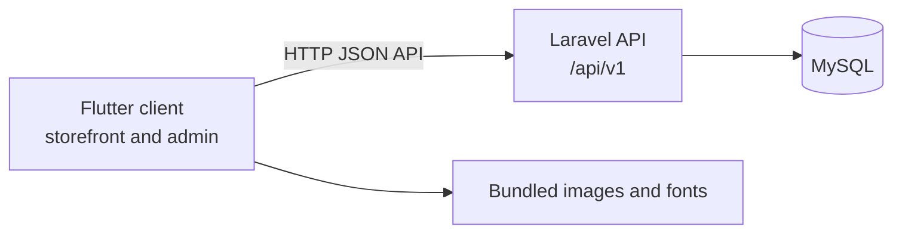

# Architecture

The Flutter client presents the storefront and admin screens. It requests JSON from the Laravel API, which reads and writes application data in MySQL.

## Main components

- `frontend/lib/features/public/` contains the public storefront pages.
- `frontend/lib/features/admin_panel/` contains the administration screens.
- `frontend/lib/core/api/` contains API endpoints and the configurable base URL.
- `backend/app/Http/Controllers/` exposes API controllers.
- `backend/app/Repository/api/` contains API data access and response handling.
- `backend/routes/api.php` defines the versioned API routes.
- `backend/database/migrations/` defines the database schema.
