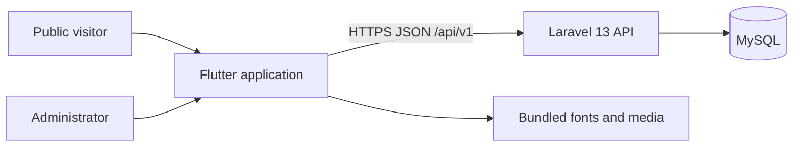
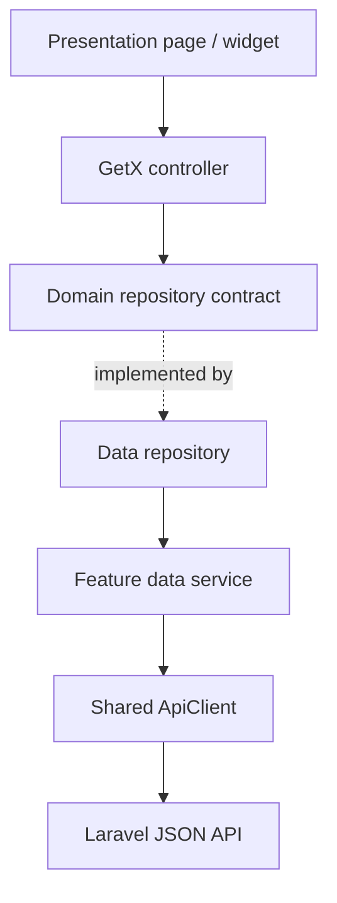
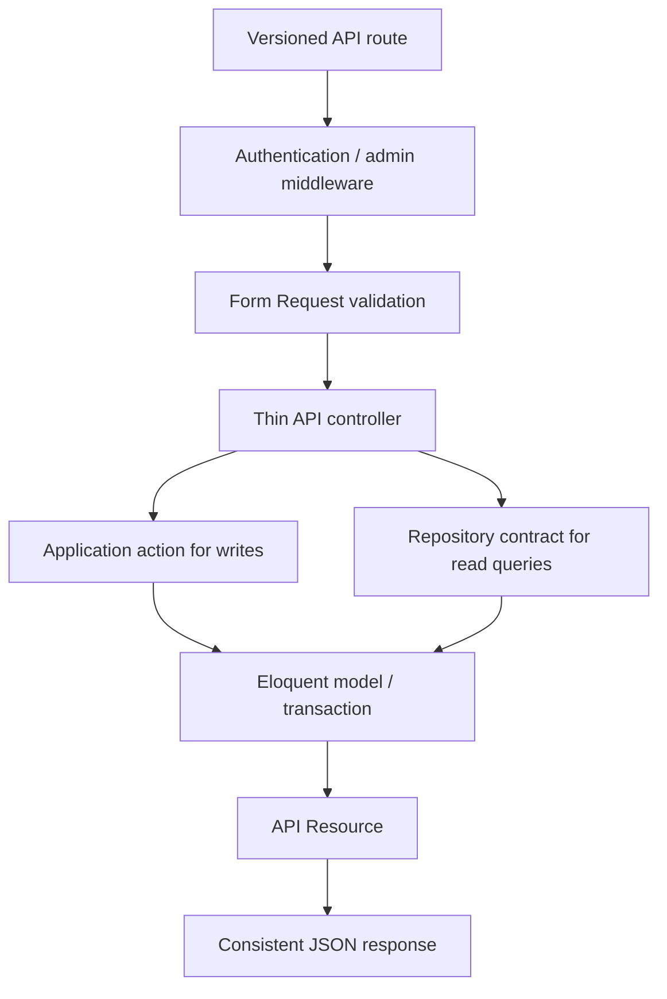

# Scup-Shop Architecture

## System context

Scup-Shop is a portfolio-focused sculpture storefront and administration application. The current runtime consists of one Flutter client, a versioned Laravel JSON API, and a MySQL database. The public catalog and editorial blog are in scope; a transactional checkout/payment flow is intentionally not part of the current product scope.

## Flutter application

### Composition and startup

- `frontend/lib/main.dart` is the application entry point. It initializes Flutter, restores the secure token store, registers application dependencies, restores the authenticated profile, and starts the widget tree.
- `frontend/lib/app/app_bindings.dart` is the composition root for shared dependencies. It registers the shared `ApiClient`, feature services, repository implementations behind domain contracts, and the long-lived authentication controller.
- Route bindings create presentation controllers for the route that owns them. Dashboard sub-pages are registered by the dashboard binding.
- Widgets/pages consume controllers through GetX bindings. They should not instantiate controllers, repositories, or HTTP services.

### Dependency direction

The intended dependency direction is Presentation → Domain contract, with Data implementing that contract. The data layer owns transport details and DTO parsing; controllers coordinate state and user intents; widgets render state and forward events.

### Shared API transport

- `core/api/api_client.dart` owns the shared GetConnect transport, API base URL, request timeout, Accept header, and optional bearer-token attachment.
- Feature services pass endpoint constants and typed query/body values to the client; they do not construct their own HTTP clients or repeat base-URL/header logic.
- `core/api/api_response.dart` owns response-envelope parsing, pagination metadata, HTTP failure conversion, and user-safe error messages.
- `core/api/api_session.dart` owns secure token persistence and the in-memory view of the current session.
- `core/api/endpoints.dart` is the single endpoint-name registry; `core/api/url.dart` resolves the configured API origin.

Configure the API origin at build time with `--dart-define=API_BASE_URL=https://api.example.com/api/v1/`. Local defaults are intended for local development only.

### Feature ownership

- `features/authentication/`: sign-in state and authentication repository contract.
- `features/public/shop/`: public product catalog.
- `features/public/blog/`: public published editorial content.
- `features/public/landing_page/`: composition of the public home-page product and editorial state.
- `features/admin_panel/products/`: product administration.
- `features/admin_panel/posts/`: editorial administration.
- `features/admin_panel/users/`: user listing and administrator-role management.
- `features/public/contact/`, `gallery/`, and `about_us/`: public information and presentation features. The real contact-delivery workflow remains an in-scope implementation item.

### Flutter conventions

- File names use Dart `snake_case.dart`; types use `UpperCamelCase`; members use `lowerCamelCase`.
- Pages/widgets do not call `Get.put` or instantiate services/repositories.
- Route-scoped controllers are created in route bindings; shared dependencies are registered in `AppBindings`.
- Controllers depend on domain repository contracts, not concrete data implementations.
- Feature services use the shared `ApiClient`; response parsing is centralized.
- Keep GetX as the selected navigation/state/dependency-management approach. Do not introduce a second state-management framework without a measured reason.
- Avoid empty pass-through abstractions. Keep a layer only when it provides a real ownership, testability, or domain boundary.

## Laravel API

### Request flow

- `routes/api.php` defines the versioned API surface.
- Middleware handles authentication and administrator authorization.
- Form Requests validate write input at the HTTP boundary.
- Controllers coordinate the request/response and should not own multi-step business rules.
- Application actions own multi-step write use cases and transaction boundaries.
- Repository contracts/implementations own reusable read-query composition.
- Eloquent models own relationships, casts, and persistence mapping.
- API Resources define stable public response shapes.
- `bootstrap/app.php` maps API validation, authentication, authorization, and not-found exceptions to a consistent JSON envelope; web routes retain Laravel's normal exception rendering.

### Current action/repository boundaries

- `Actions/Admin/ManageProducts` owns product creation/update/deletion and inventory transactions.
- `Actions/Admin/ManagePosts` owns post create/update/delete use cases.
- `Actions/Admin/ChangeUserRole` owns role-change invariants, including stale-actor checks, self-demotion prevention, and last-administrator protection.
- `Actions/Auth/AuthenticateUser` and `Actions/Auth/RegisterUser` own credential verification, safe account creation, and Passport token issuance.
- Product, post, and user repository contracts return paginated query results; controllers apply API Resources and build the JSON envelope.
- The user repository contract owns the paginated account-list query.
- Authentication no longer uses a repository layer; the active login and registration flows use focused application actions.

### Container bindings

`AppServiceProvider::register()` binds repository contracts to their Eloquent-backed implementations. Controllers request the contract, not a concrete repository class. Application actions are resolved through Laravel's container.

### Backend conventions

- Use PSR-4 namespaces and Laravel's standard directory ownership.
- Form Requests validate every write endpoint; avoid inline `$request->validate()` in controllers.
- Controllers return explicit JSON response types/status codes and API Resources.
- Put transaction boundaries around multi-row operations in an application action.
- Repositories should not mix unrelated write workflows, request validation, and HTTP response formatting.
- Avoid unused imports, stale commented-out code, and duplicate abstractions.
- Preserve legacy table/column names where a rename would create unnecessary migration risk; use explicit Eloquent mappings when needed.

## Security and deployment boundaries

- The Flutter client sends bearer tokens for protected API requests; Laravel Passport authenticates those requests.
- Production API traffic must use HTTPS.
- Set `CORS_ALLOWED_ORIGINS` to the exact deployed Flutter Web origins.
- Set `TRUSTED_PROXIES` only to the actual reverse-proxy addresses/CIDRs.
- Do not commit runtime secrets. Supply deployment-specific configuration through environment variables/secret management.
- Do not log access tokens, passwords, or unnecessary personal data.

## Explicit scope boundaries

- The current product is a portfolio-quality storefront/admin/API demonstration.
- Cart, checkout, order processing, and payment are not claimed as implemented.
- The contact form must not report success until the backend/email workflow accepts the message.
- USD is the intended display currency; legacy Toman-denominated seed/catalog values must not be relabeled as USD without approved source prices or a documented conversion policy.

## Architecture follow-ups

- Extract authentication registration/token issuance from the legacy auth repository into focused application actions.
- Complete the naming/path normalization batch after a verified backup tag is available.
- Decide which empty legacy landing data-layer files can be removed after reference and history checks.
- Add the real contact application service and mail-delivery boundary when implementing the contact feature.
